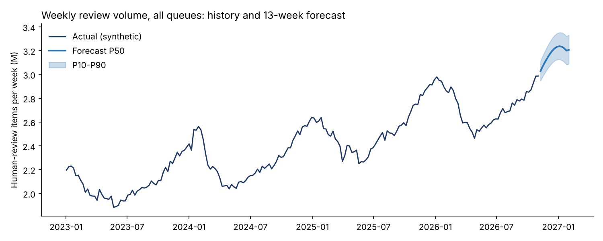
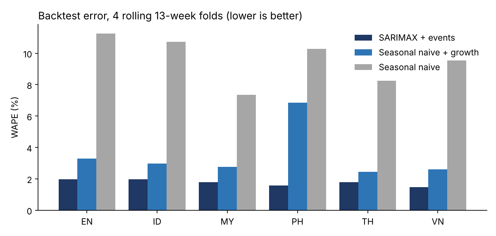
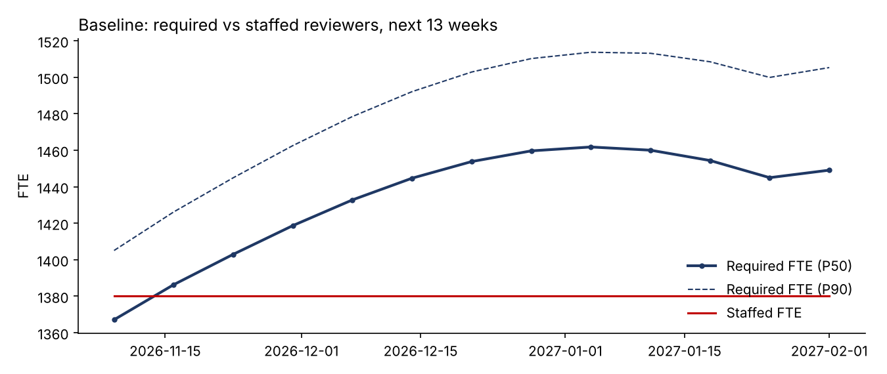
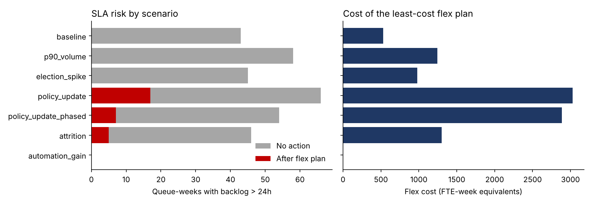
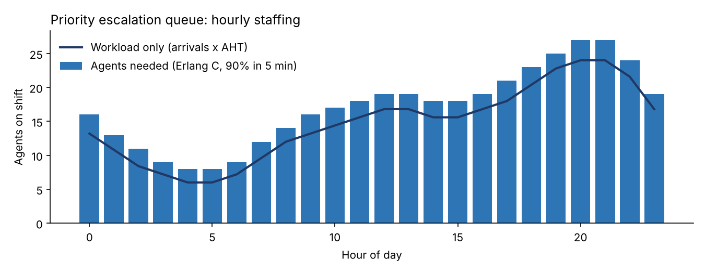

# Content-Review Capacity Planning: Forecast, Headcount & Scenario Model

How many content reviewers does a multi-market moderation operation need next quarter, where will it fall short, and what's the cheapest way to cover the gap when volume spikes, a policy changes or people leave?

This project forecasts weekly human-review volume for 6 market/language queues, converts it into reviewer headcount (handling time, shrinkage, utilisation, QA), tests that against staffed capacity with a backlog/SLA simulation, runs 7 what-if scenarios, and uses a linear program to allocate flex capacity (overtime, vendor surge, cross-skilled reviewers, new hires) at least cost. A real-time escalation queue is sized separately with Erlang C. The plan is also delivered as an **editable Excel model** with live formulas.

**Stack:** Python (pandas, statsmodels, PuLP) · Excel (openpyxl, formulas) · pytest

> **Synthetic data.** Volumes, handle times, headcount and costs are illustrative assumptions (`src/capplan/params.py`) for a made-up operation, not any real company's. The point is the method and the relative comparisons between scenarios.

## Key results

| | |
|---|---|
| Data | 201 weeks (Jan 2023 – Nov 2026) × 6 queues, generated daily with trend, annual seasonality, weekday pattern, known events (elections, Ramadan, Tết, Songkran) and one unannounced policy shift |
| Forecast accuracy | SARIMAX + event regressors: **1.8% WAPE** across 4 rolling 13-week backtests, vs **3.5%** for seasonal naive + growth (the spreadsheet method) and **10.2%** for plain seasonal naive; P10–P90 interval held 85% of actuals (target 80%) |
| Baseline gap | Staffed for recent volume (1,380 FTE), the year-end peak needs up to **1,462 FTE**: a **82 FTE (5.6%) shortfall** in the worst week |
| Without action | Backlog passes the 24h SLA in **all 6 queues from week 6–8** (mid-December) and reaches 4.4 days of work |
| Least-cost fix | Overtime alone, within a 5% wellbeing cap, clears the baseline: **0 SLA-risk weeks**, 528 FTE-week-equivalents of flex cost |
| Hardest scenario | A policy change raising handle time 15% for 6 weeks can't be fully flexed out (17 queue-weeks still at risk); **phasing the rollout in two waves cuts that to 7** and lowers cost 5% |
| Escalation queue | Erlang C needs **16% more agent-hours** than a workload-only count to hit 90% of items within 5 minutes (≈102 FTE) |



## 1. Forecasting review volume

Each queue's weekly volume is modelled on the log scale with **SARIMAX(1,1,1)** plus a drift term, **Fourier terms** (K=3) for annual seasonality, and **event regressors** (the share of each week's days inside a known event window). Events are known in advance, so they can be placed in the forecast horizon too. A Tết window falls in the last forecast week, for example.

Accuracy is checked with a **rolling-origin backtest**: 4 consecutive 13-week windows covering the last year, each forecast only from data before it. Error is measured as WAPE (total absolute error ÷ total volume), so busy queues count more, which matches how errors turn into headcount.

| Queue | SARIMAX | Seasonal naive + growth | Seasonal naive | P10–P90 coverage |
|---|---:|---:|---:|---:|
| EN | 2.0% | 3.3% | 11.3% | 81% |
| ID | 2.0% | 3.0% | 10.7% | 90% |
| MY | 1.8% | 2.8% | 7.3% | 83% |
| PH | 1.6% | 6.8% | 10.3% | 88% |
| TH | 1.8% | 2.4% | 8.3% | 79% |
| VN | 1.5% | 2.6% | 9.5% | 90% |
| **All** | **1.8%** | **3.5%** | **10.2%** | **85%** |



**Why the baselines miss:** "same week last year" ignores growth, and moving events (Ramadan, Tết) and one-off events (the Philippine election in May 2025) land in the wrong week. PH shows this most clearly: its seasonal-naive-with-growth error is 6.8% because last year's election spike is copied into this year.

**Caveat:** the data was generated with the same structure the model uses (trend, Fourier-shaped seasonality, multiplicative events), so the 1.8% is optimistic. Real queues would be noisier. The comparison between methods is the useful part.

## 2. From volume to headcount

```
workload hours  = items × (1 + QA re-review rate) × AHT / 3600
productive hrs  = 40 contract hours × (1 − shrinkage) × utilisation        = 40 × 0.70 × 0.85 = 23.8
required FTE    = workload hours / productive hours per FTE
```

Shrinkage (30%) covers leave, training, meetings and wellness breaks. Utilisation (85%) is the share of available time actually spent handling items.

Staffed capacity is then tested week by week with a **backlog simulation**: work not done carries into the next week, and a queue is flagged **SLA at risk** when carried-over backlog exceeds one day of that week's work, meaning that under first-in-first-out some items have waited more than 24 hours.



Headcount was set about 6% above the last 8 weeks' requirement, which is staffed for recent volume rather than the year-end peak. The forecast rises 7% into late December, so a small weekly gap compounds into backlog. Every queue crosses the SLA line in weeks 6–8 even though the average shortfall is only 3.7%.

## 3. Scenarios

| Scenario | What changes | Worst-week shortfall | SLA-risk queue-weeks (no action → after flex) | Flex cost* |
|---|---|---:|---:|---:|
| baseline | P50 forecast, current headcount | 82 FTE | 43 → **0** | 528 |
| p90_volume | Volume at the 90th percentile every week | 134 | 58 → **0** | 1,242 |
| election_spike | Snap election: MY +40%, EN +10% in weeks 6–10 | 157 | 45 → **0** | 982 |
| policy_update | AHT +15% everywhere for 6 weeks, +5pp shrinkage for retraining | 377 | 66 → **17** | 3,026 |
| policy_update_phased | Same policy in two waves (vendor-supported queues first) | 341 | 54 → **7** | 2,886 |
| attrition | 8% of ID and VN reviewers leave by week 4 | 123 | 46 → **5** | 1,302 |
| automation_gain | Machine pre-filtering removes 10% of volume from week 5 | 39 | 0 → **0** | 0 |

\* Cost in FTE-week equivalents (one in-house FTE-week = 1.0; overtime 1.5×, vendor 1.3×).



**What stands out**
- **A local spike is far cheaper than a system-wide shock.** A 40% election spike in one market costs a third as much as a 15% handle-time increase everywhere, because other queues still have people who can lend a hand.
- **Cross-skilling does the heavy lifting in the election scenario.** English-capable reviewers in the EN queue take MY's English-language content (142 FTE-weeks), and a vendor backfills EN (238 FTE-weeks). With no action, MY's backlog would reach 17.5 days of work.
- **Policy changes need a rollout plan, not just more people.** In-house hires take 8 weeks to become productive and the vendor can only staff three queues, so a big-bang rollout still breaches the SLA in 17 queue-weeks. Phasing it (ID, PH, EN in week 3; TH, VN, MY in week 8) leaves 7, and the second wave lands when the new hires arrive.
- **Attrition is a lead-time problem.** Losing 8% of two queues is only 42 people, but backfills can't be productive before week 9. ID is covered by overtime and vendor support; VN has no vendor option, so it breaches the SLA in weeks 6–10 even with full overtime and 36 hires. The fix is a VN vendor contract or cross-training, not more hiring.

## 4. Allocating flex capacity (linear program)

For each queue *q* and week *t*, in handling hours (PuLP / CBC):

```
supply[q,t]  = staffed + overtime + vendor + new hires (after the 8-week lead time)
               + lent from EN (PH, MY only) − lent to other queues (EN only)
backlog[q,t] ≥ backlog[q,t−1] + workload[q,t] − supply[q,t],   backlog ≥ 0
breach[q,t]  ≥ backlog[q,t] − workload[q,t] / 7                 (backlog beyond one day)

min  1.5 × overtime + 1.3 × vendor + 1.0 × 13 weeks × hires
     + 10 × breach + 0.1 × backlog                               (all in FTE-week equivalents)

caps: overtime ≤ 5% of staffed hours · vendor only for ID / PH / EN, ≤ 40–60 FTE, from week 3 ·
      EN can cover ≤ 30% of PH and ≤ 25% of MY workload (their English-language share) ·
      ≤ 40 hires per queue
```

Hires are charged for the whole quarter because they're paid during onboarding. They also stay into next quarter, which this one-quarter model doesn't credit, so it leans away from hiring.

## 5. Escalation queue (Erlang C)

Priority reports (e.g. urgent live-stream reports) need a pickup time in minutes, not a 24h backlog, so they are sized with **Erlang C** by hour of day: 240 items/hour at the evening peak, 6-minute AHT, target 90% picked up within 5 minutes.



Dividing workload by hours would under-staff by 16%. Erlang C adds the idle time needed so items rarely queue. Occupancy averages 86%, and is lowest overnight when volume is thin. Converted to FTE (7 days, 30% shrinkage) that is about 102 reviewers.

## Excel model

`outputs/capacity_model.xlsx` is the planner-facing version:

| Sheet | Contents |
|---|---|
| Inputs | Contract hours, shrinkage, utilisation, QA rate, AHT and staffed FTE per queue; **yellow levers**: volume and AHT multipliers per queue, P50/P90 switch, shrinkage change |
| Forecast | 13-week P50 and P90 volume per queue (from the Python model) |
| Required_FTE | Live formulas: items × levers × (1 + QA) × AHT / 3600 / productive hours |
| Gap | Staffed − required per queue and week, shortfalls shaded red, worst-week and average summary |
| Escalation_ErlangC | Hourly Erlang C staffing with totals and FTE conversion |

All 261 formulas recalculate with no errors, and the baseline figures match the Python output (worst-week shortfall 81.8 FTE). To test the election scenario in Excel, set MY's volume multiplier to 1.40 and EN's to 1.10.

## Run it

```bash
pip install -r requirements.txt
python scripts/run_all.py     # ~10 s: data, backtest, forecast, scenarios, LP, Excel, charts
pytest                        # 11 tests
```

## Project structure

```
src/capplan/
  params.py      all assumptions, event calendar and scenario definitions
  generate.py    synthetic daily volume per queue
  forecast.py    SARIMAX + Fourier + events, baselines, rolling backtest
  capacity.py    workload → FTE, backlog/SLA simulation, Erlang C
  scenarios.py   apply scenario levers, measure gap and SLA risk
  allocate.py    least-cost flex allocation (PuLP)
  excel.py       editable Excel model with live formulas
scripts/run_all.py
tests/test_capplan.py   hand calculations, Erlang C table value, scenario levers, LP caps
data/       daily_review_volume.csv, weekly_review_volume.csv
outputs/    forecast_13w.csv, backtest_*.csv, capacity_plan_by_scenario.csv,
            flex_allocation_by_scenario.csv, scenario_summary.csv, escalation_erlang_c.csv,
            headline_metrics.json, capacity_model.xlsx, charts/
```

## Limitations and next steps

- **Synthetic data**, built with the same structure the model assumes, so forecast error is optimistic.
- **Weekly granularity.** Intraday arrival peaks for the 24h-SLA queues are not modelled; a daily or hourly simulation would show where within a week the backlog builds.
- **AHT is fixed per queue.** In practice it varies with content mix (video length, language, policy area) and reviewer tenure; modelling AHT by content type would sharpen headcount.
- **One-quarter horizon** under-credits hiring. A rolling 2–3 quarter plan would weigh hires against recurring vendor cost.
